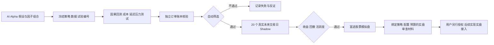

# AI 量化实验室：先 Shadow 与模拟盘，再单独审查实盘

当前共用 **USD 1,000,000 美股模拟账户**：股票账本初始本金 **USD 900,000**，期权 **USD 100,000**。执行额度分别受最新券商净资产的 90% / 10%、各自账本现金和未完成委托约束，不使用融资购买力；历史回测仍以 USD 10,000 为标准本金。代码在 `quant_agent/`。
行情和模拟账户使用 **Futunn AppKey REST，无 OpenD**。当前会话没有暴露 Futu MCP 工具；MCP 的 quote-read 授权也不等于交易授权。

## 本地、常驻服务器、Codex Work 的分工

| 环境 | 适合工作 | 连续监控的条件 |
|---|---|---|
| 本机 stock-agent | 调试、行情接入、回测、模拟账户对账 | 常驻进程、电脑不休眠、有网络；LaunchAgent 登录后启动及异常重启 |
| 自己的 VPS / 云主机 | 长期数据采集、风控、模拟执行、稳定时间表 | systemd、持久磁盘、备份、外部健康检查；服务与电脑是否开机无关 |
| Codex Work / Codex Cloud | 批量研究、实现因子、审查实验、分析复盘、提出代码变更 | 配置云环境、网络与身份；安排任务。不能把聊天任务等同于券商订单的持久在线服务 |
| Codex CLI | 本地/服务器程序调用 AI，JSON schema 结构化分析 | `codex exec` + 登录/额度 + 超时；由程序或调度器触发 |

本地量化完全可以用 AI：本机 Ollama daemon 可以请求云模型，也可以调用 OpenAI 兼容后端或 Codex CLI。
本机负责落盘、风控和执行，并不意味着 AI 推理必须在本机。

官方最新文档说明：云任务可在电脑休眠时继续；当前默认云 VM 状态在最后一次开始/恢复任务后可恢复至多七天。
云环境的新任务从发布环境启动，各任务文件分开；不能默认带上本机密钥、个人 Skills 或账户授权。
Work 的长期工作、定时任务可以做研究，但任务连续运行、额度、需要用户决定和环境状态都要纳入运维。
不要把模型响应延迟放进一分钟级风控循环。

推荐：**常驻 Python 执行与监控服务 + 独立 AI 研究/复盘工作线程**。后续把服务迁到自己 VPS，再用 Work 做研究控制台。
不需要为了量化先把券商交易密钥搬进 Codex 云环境。

官方资料（2026-10-10 已读取）：

- [Codex CLI 非交互执行与 JSON schema](https://developers.openai.com/codex/noninteractive)
- [当前云环境、秘密管理、VM 状态与限制](https://learn.chatgpt.com/docs/environments/cloud-environments)
- [长期工作与 Goal](https://learn.chatgpt.com/codex/long-running-work)
- [定时任务：本地要求机器及 App 运行](https://developers.openai.com/codex/app/automations)

## 流程与实际权限



SQLite 状态、事件和累计成交可重启恢复。阶段用条件更新防止跳级；实盘交易端点不在适配器白名单。
研究与每日复盘不阻塞订单核对。正常开市时每 60 秒核对重点报价、订单与风控，广池每 300 秒扫描。另用无 OpenD WebSocket 接收最多40只重点标的基础报价；执行仍经 REST 核验。当前已验证 AppKey 鉴权、订阅确认及 QUOTE / MARKET_STATE 消息，连续新鲜推送和长连接刷新需开市观察。

## 看板与任务调度

### 日线与分钟研究共存（2026-10-20）

`intraday_enabled` 只开启额外的分钟研究与执行能力，不关闭日线组合研究、日线表达式生成、独立核账或有效数据上的日线 Shadow 观察。
收盘流程在同一后台工作线程中依次运行两条研究链；各自的版本和检查点分别保存，一条链的失败不会跳过另一条链。
日线检查点不包含分钟数据或分钟引擎版本；旧的“分钟已完成”标记不能冒充日线研究已完成。两类结果分别展示周期、样本区间和失败门槛。

原始历史回测仍不可变，新收盘数据生成新的研究版本。历史修订造成的执行数据阻断继续显示，不通过恢复日线研究自动批准修订。
研究共存不创建第二份账户资金：模拟账户仍只有一个账户优胜策略和一条持久化交接流程。分钟执行启用期间，日线候选只研究/观察，不经旧日线晋升器覆盖现有账户选择；跨周期账户竞争仍须同区间、同成本单独比较，不能以页面跨区间收益排名直接换仓。

看板由本机 Python 服务提供，包含历史净值与 QQQ 对比、回撤路径、成本/延迟压力、
资金占用、指数/自选异动、带时间戳资讯、策略门槛、Codex 复盘、因子代码和任务记录。
顶部导航分为总览、策略、市场、模拟、复盘、运行。总览保留紧凑交易日时间轴、五项账本指标、
主图、复盘重点和待关注事项；长篇规则、风险检验、历史版本与完整复盘默认折叠。
策略页优先展示运行/观察卡片，已淘汰版本默认隐藏，可勾选查看；图中买卖点直接跳转对应日的明细。
每日损益使用上一交易日最后估值作基准；当日估值须晚于最新成交核对，盘中须在120秒内，
否则显示等待估值。无成交时明确标为初始资金。成交次数按纽约日期的核对时间统计。
行情日期、采集时间、资讯观察时间、复盘基准交易日分别显示；最新完成交易日的休市缓存不误报为盘中过期。
页面每15秒读取本地证据，时钟每秒更新，后台标签页暂停页面轮询。内容不变的图表保留SVG和悬浮提示，
行情/委托/成交表仅替换变化行；保留日期、方向筛选、展开记录数、折叠状态和各页面滚动位置。
模拟操作区显示委托状态、部分/累计成交、成交增量、已实现和未实现损益、估算费用及账本净值曲线。
成交时间是核对时间；费用默认30bps估算，未使用券商结算佣金；核账采用平均成本。
没有模拟成交时显示等待状态，不能把回测曲线或 Shadow 假设成交写入模拟实绩。
历史图表从冻结数据与引擎重建，并核对收益、回撤、成本、订单数、暴露和样本数一致；
新回测会保存每日曲线。未来 Shadow 使用真实观察记录，没有记录时显示空状态。
历史、Shadow、券商模拟三种曲线明确区分。点击策略列表或选择策略后可查看交易详情：
累计订单、买卖金额、费用、已实现/未实现损益，以及每日净值、现金、持仓市值和收益。
每日表可点选日期，买卖明细支持日期/方向过滤和展开更多记录。
净值图中**红点买入、绿点卖出**；悬浮显示标的、股数、价格、金额，点击筛选当天明细。
右上角可切换白天/黑夜主题，偏好保存在浏览器本地。图表只使用自定义提示，
不再同时触发SVG原生`title`提示；自定义提示置于页面外层，按视口边缘调整位置。
这些点是净值上的交易日标记，纵坐标不是标的成交价。历史交易使用复权股数、假设开盘成交、25bps费用；
仅在冻结数据、引擎和原回测六项指标一致时重建，缺材料的旧版本明确显示不可用。
Shadow只纳入已封存观察日；未封存计划单独提示。模拟记录只来自该策略的实际模拟委托/成交，
账本曾有多个策略时不将账户总净值归给单个策略；没有模拟成交时不绘制模拟收益路径。

### 七个交易日收益预测

在「历史 + 预测」图中，默认附加策略与QQQ的未来七个XNYS交易日统计情景。
竖线标识今天的分界（北京时间；行情截止日另列），未来使用虚线中位数和10%–90%区间带，
未来区域没有买卖点。历史与未来在各自区域内按交易日等距绘制，未来区域单独展开；
预测卡片显示相对最后收盘净值的变化率，主图纵轴继续显示相对初始资金的累计收益。
可取消勾选「未来7个交易日」恢复纯历史曲线；Shadow仍记录实际未来观察日的假设成交。

只读接口为`GET /api/forecast/<strategy-id>`，实现于`quant_agent/forecast.py`。
使用最近最多63个对齐的已完成日收益（至少40个）：策略对QQQ的市场Beta以1.1倍方差作分母，约缩减9.1%，
策略Alpha与QQQ窗口平均日收益漂移保留25%，QQQ近期10日动量差保留20%并逐日以0.75衰减；
按3日块联合重采样4096条路径，保留市场与策略残差的共同历史变化。
同一QQQ输入使用相同随机种子，确保各策略的QQQ基准预测一致，重复读取不会随机改变预测。
仅在冻结曲线覆盖最新已收盘交易日、净值有效且训练窗口无缺日时展示。

这是一份**未经未来样本验证、区间未经校准的统计预测**：包含当前选股和已查看回测的选择偏差，
未逐日重演未来选股、调仓及额外交易费用。预测不写入冻结回测、Shadow或券商账本，
不改变历史收益排名或执行规则；网页预测请求不调用券商或AI。新数据版本生成新预测，
缺少最新收盘材料的旧版本会明确显示不可用。

### 预测兑现记录

`quant_agent/forecast_tracking.py` 在服务启动和每日工作线程结束后运行；也可执行
`.venv/bin/python -m quant_agent forecasts` 手动封存/核对。只读取本地完成日线，不请求券商或AI，
不改预算、策略阶段、委托或Shadow。预测核验故障独立记录，不阻塞订单风控。

第一场未来交易日开盘前，原预测、模型、净值曲线、冻结规则与成员证据被不可覆盖地保存到运行目录。
已开盘的预测不能补记。缺少成员时，只能在该开盘时点前从输入hash完全匹配的历史数据版本补充独立材料；
原封存文件保持原样。七日到期后，用原成员、引擎、开始日期和费用复算到终点；原区间的日期、净值、
现金和持仓数须与封存曲线一致，原行情prefix hash存在时也须一致。修订、缺日、缺成员或引擎变化均标为材料待核对。
后验路径明确标为**冻结规则的事后复算**，不称为未来观察或模拟成交。

运行页显示封存数、核对数、待到期记录、七日终点策略收益的平均绝对误差（百分点）和QQQ终点情景区间覆盖率。
完全相同的QQQ预测只计一个样本；没有到期样本时指标显示空值。区间覆盖率只是已核对样本统计，不表示区间已校准。
网页GET只读取已保存的汇总，不封存或回填记录。

实际调度是 **LaunchAgent → Python supervisor → 工作线程 → Codex CLI**，本项目未创建 Codex Work/App 定时任务。
网页刷新只读取本地数据库和材料，不触发行情请求、Codex 分析或订单。

| 时间/条件 | 工作 |
|---|---|
| 服务启动 | 一次账户对账，恢复必要状态 |
| 开盘前5分钟 | 一次账户预检 |
| 美股正常交易时段 | 每60秒重点行情、对账与风控；全池每300秒；重点最多40只推送；资讯每1800秒；开盘后的前5分钟生成日线计划 |
| 收盘后 | 封存未来 Shadow，继续核对未完成订单 |
| 收盘15分钟后 | 每个交易日一次：历史更新 → 当前指数/自选/异动入池 → 资讯 → 新版本候选 → 回测 → Codex复盘 → 新因子代码与独立验证 |
| 周末/休市，日任务已完成 | 本地调度待机，网页仍可访问；不进行正常行情周期轮询 |
| 未完成/未知订单，或任务失败 | 保留必要对账；任务按至少一小时退避重试 |

时间由 XNYS 交易日历决定，识别节假日、提前收市及夏令时，看板统一显示北京时间。
正常时段一般为夏令时21:30–次日04:00、冬令时22:30–次日05:00；以交易日历为准。
后台进程保留用于网页、唤醒和状态恢复，不代表全天调用券商或模型。

Codex 调用通过 `subprocess.run` 把结构化证据从标准输入送入 `codex exec`，
用 `--output-schema` 约束 JSON、`--output-last-message` 取回结果，并再次进行 schema/权重校验。
使用当前登录和额度，显式指定 **gpt-6.1-sol / high**，单次240秒超时。
CLI 使用 `--ignore-user-config`，因此必须显式传入 `--model` 和 `model_reasoning_effort`；看板展示运行头的实际模型/档位。
假设生成、每日复盘及新因子设计是不同调用；回测与筛选由 Python 执行。

自动任务已启用，也可在仓库根目录手动执行研究命令：

```bash
.venv/bin/python -m quant_agent discover --ai  # Codex 提出候选
.venv/bin/python -m quant_agent research       # 注册候选的回测、核账、筛选
.venv/bin/python -m quant_agent charts         # 重建尚无图表的同版本历史实验
.venv/bin/python -m quant_agent trades         # 核对并重建同版本历史交易账本
.venv/bin/python -m quant_agent brief --refresh  # 更新简报证据并调用 Codex；不触发下单或策略注册
```

`tick --daily` 与常驻执行器互斥；若确需手动跑每日流程，先停止服务，执行该命令后再 install 启动。
已完成的当日流程会跳过，不会因手动命令反复生成相同复盘。每个数据版本最多30个试验，全部累计试验保留，单版本上限不自动提高。

### Alpha 生成

AI 可选择已实现的风险/调仓模板，并把 momentum_risk、momentum_blend、residual_momentum、path_quality、near_high 的
截面百分位排名按权重组合，最多四因子、权重和为一。因子逐日计算，不能读取未来日期；无 `eval`、无任意代码执行。
每个组合、数据版本和执行引擎生成新策略哈希；每个数据版本默认最多30个试验，累计试验全部登记，不只保存赢家。
达到试验上限后停止新增候选，继续已有版本的验证、监控和每日复盘；不会自动提高上限。
新版本每日最多生成1个新表达式因子。模型输出受限 DSL：价格、收益、动量、波动、成交量/额等字段；算术、滚动均值/标准差、向过去 lag、绝对值与截面排名，最多15节点。
确定性编译器写入 `research/evolved_factors/factor_<hash>.py`，保留代码、表达式、假设、反证条件与版本。
模型用有向节点表表达公式，只能引用此前节点。拒绝重复排名、无效节点、未来引用及与已有因子完全相同的排名。
先检查前缀不变、未来扰动不影响过去及有效覆盖；因果失败也登记为淘汰候选，模型响应落盘后重试复用原提案。
通过后重新接受回测、成本/延迟压力、独立核账和真实未来 Shadow。生成新代码不会覆盖已有运行版本，也不会自动改预算、执行适配器或门槛。
未知算子、行业、新闻时点及期权字段须先补数据与实现再扩展 DSL，当前仅将标题用于提出研究假设。

### 回测与独立验证

复用 Daily Factor Lab 的因果指标和独立 `audit_ledger`，另建统一决策函数给研究/Shadow/模拟盘使用。
220 个交易日暖机后按 60% / 20% / 20% 顺序切分。验证与测试须盈利、测试不少于52日/10单、各段回撤≤15%、
单边50bps与额外一日信号延迟后须盈利、测试收益超过同期 QQQ。条件在实验前冻结。
研究假设是调整价格上的整数股、前一日信号/下一日开盘加成本；当天卖出资金不用于当天新买入。
计入交易成本、现金、净值、未平仓市值/暴露、回撤；独立账本逐单重建实际模拟现金及股份。

**已有历史已被看过，当前自选股池有幸存者/选择偏差，股息现金流未计入。**
历史切分不是未触碰验证集；独立核账不是独立行情验证，也不证明 Alpha 有效。
真实未来 Shadow 必须在冻结之后开市，从实际观察报价生成并在同日收市后落盘；不能回填历史来凑20天。
至少20个未来观察日、净值高于初始值、回撤≤10%、至少5单才能进入模拟盘。若没有策略通过，系统保持观察。

### 执行与隔离

- 已验证的美股模拟账户来自 `/api/v1.0/sim-trade/accounts`。实际返回 market=100、account_title=美股融资融券模拟账户。
  不套用文档中与实际列表矛盾的市场编号。所有账户读请求显式带 `market=100`。
- 模拟账户初始现金100万美元；**10,000/1,000 是程序自己的限额，并非券商独立子账户**。
  当前股票模拟账户为空。外部持仓或外部挂单出现即暂停，不能把已有个人仓位自动纳入 AI 管理。
  真正隔离实盘时优先独立券商账户、独立资金和最小交易权限，并核实富途是否允许该账户类型。
- 两个资金桶分别记现金/持仓；买入按现有市值、在途预留、手续费保守预留和新订单检查。
  不读取 margin buying power 来放大仓位。亏损不会自动补款；收益也不能使承诺资本突破预算。
- 只开多仓。期权按每张100股的完整权利金加手续费计占用；裸卖、没有持股的备兑以及不够现金的 Put 均拒绝。
- 当前只有股票模拟 limit 单接入。期权模拟账户/市场、历史 bid/ask、Greeks、到期、提前行权和实物交割未验证，**期权执行关闭**。
  1,000美元不能现金担保接100股 NVDA；需要另外划拨接货现金，不能把保证金当现金担保。
- 资金预留和 order intent 先落盘，再提交。应用级 client marker 便于查找，但不假设券商实现幂等。
  超时或进程在提交中崩溃时记为 unknown，通过当日/分页历史订单和 client marker 查找；不盲目重复提交。
- 累计成交只记增量；部分成交保留剩余预留；取消须经券商状态确认才释放。
  卖出回款在下一交易日开市前锁定。手续费采用30bps保守估计，不冒充券商实际佣金结算。
- 只在美股正常交易时段前5分钟生成每日计划。报价≤90秒、同交易日、双边盘口、价差≤50bps；价格漂移>50bps跳过。
  5分钟后取消未完成的当日计划限价单；部分成交取消若券商不支持会暂停并要求处理，不假定已经取消。
- 最新已收盘历史缺失、调整价格与原始股价基准不符、历史修订、未核对订单、仓位差异、回撤15%或日亏损2%均暂停新增执行。
  熔断不会擅自市价清仓；仍核对现有订单并尝试取消超时挂单。

## 运行

在仓库根目录执行，运行文件写入 `~/.local/share/stock-agent/quant-agent/`，权限700/600，私钥留在既有外部文件。

```bash
.venv/bin/python -m quant_agent init --discover-account
.venv/bin/python -m quant_agent probe
.venv/bin/python -m quant_agent refresh
.venv/bin/python -m quant_agent scan --enrich
.venv/bin/python -m quant_agent news
.venv/bin/python -m quant_agent push-probe
.venv/bin/python -m quant_agent evolve
.venv/bin/python -m quant_agent discover --ai
.venv/bin/python -m quant_agent research
.venv/bin/python -m quant_agent tick
.venv/bin/python -m quant_agent serve
```

看板：[http://127.0.0.1:8791](http://127.0.0.1:8791)；仅本机只读，不能从网页下单。
`config.json` 的 `ai_provider` 可选 `codex`、`ollama`、`configured`。按用户最新要求，**量化框架默认使用 Codex CLI，本轮研究与每日复盘不依赖 Ollama**。
模型失败或格式不合格会保留失败事件，不自动换模型/放宽约束；确定性风控不依赖 AI 在线。
复盘失败后至少等待一小时再重试，不把失败标记为当日完成；失败材料保留，成功重试另存证据。
Codex 以 `--ignore-user-config --ephemeral --sandbox read-only --output-schema` 在临时目录分析，显式指定 `--model gpt-6.1-sol -c model_reasoning_effort="high"`，超时240秒，
不传券商环境变量、不加载用户 MCP。**read-only 不等于系统级读取隔离**；强隔离部署用独立 OS 用户或容器。
该调用禁用 shell、浏览器、App、插件、记忆和多代理工具，并关闭 web_search；程序已经提供富途证据，AI只需返回分析JSON。
配置的项目后端仍使用项目原来的 timeout/retry；长期部署宜选有界的 Ollama/CLI 适配器。

`auto_refresh=true` 启用每日完整历史缓存更新；`daily_research=true` 启用新数据版本上的 AI 候选和实验。
自动更新写新目录，发现复权历史修订拒绝拼接，随后全量重载发生修订的标的，生成新数据版本。
错误报告保留，旧数据不被覆盖；受影响的 Shadow 版本淘汰后重新研究，已有模拟仓位的版本先暂停处理；缺新数据时交易会阻断。
每日报告和实验原始证据在运行目录 `reports/`、`artifacts/`；看板展示失败门槛和真实行情日期。
资讯优先使用 Futunn REST `quote/find-news`，失败时使用官方 news-search Skill API。
每次最多12个动态重点标的、每个3条，从持仓、技术候选、异动及QQQ/SPY选择，
保留原链接、published_at、首次 available_at 和来源。
只接受过去7天且未在未来发布时间的标题；AI 分析按首次观察时间过滤，不将今天获取的旧新闻回填历史。
当前是标题级证据，未核实全文、实体事件或因果归因；尚未建立历史新闻回测因子。

每日简报使用 Codex CLI `gpt-6.1-sol / high`，包含重要事件、市场温度、主线判断、
美股四类扫描（抄底观察/资讯催化/强势延续/走坏回避）、A股/港股方向、有用结论、模拟操作复盘和覆盖缺口。
每个候选给观察触发、失效条件和风险点，重点高亮，并附输入证据来源。无证据的类别可以为空。
技术筛选使用本地完整Futunn复权日线的MA5/10/20、20日回撤/前低、5日收益和量比；
全池快照数量与完整日线覆盖分别展示，不能把技术修复当成基本面已核实。
主题资讯通过官方Futu news-search Skill API检索美联储、AI、A股、港股，每主题最多8条、过去72小时；
不足4条时复用本项目见闻/东方财富公开市场标题源。跨市场指数与行业ETF使用Futunn REST快照；
美元指数、美债10年收益率、美元兑人民币及原油/黄金近月期货暂无本配置已验证的富途原始序列，
使用Yahoo Finance/yfinance备用日线，单独标注来源、交易日期、单位和期货口径。
简报在收盘每日流程生成；盘中每30分钟更新资讯证据不等于每30分钟重跑AI全文。
结构化简报保存到`reports/<asof>.brief.json`，中文Markdown保存到`reports/<asof>.md`；
0成交只复盘研究门槛与证据缺口，不编造执行经验。新因子继续走版本化验证，不能改写冻结运行策略。

## 自选股、市场异动与用户原有 .quant 参考

每日读富途 `user-security` 的 US 普通股自选，和 `valuation/index-stocks` 的当前成分股合并。
指数代码为 `US..NDX`、`US..SPX`，50条分页，核对总数、去重和终止游标，名单与观察时间归档。
2026-10-10 实际观察为纳指100共101个证券代码、标普500共503个；合并155只自选后去重595只，快照无缺失。
快照按官方单批上限400拆批，盘中每300秒扫描，未返回标的单独列出；成分和自选每日更新。
名单是当前观察成分，不能冒充历史时点成员；全量扫描不等于全部已有完整历史或全部能参与当前策略。
筛选价≥5美元、当日成交额≥2000万美元、日涨跌绝对值≥3%的普通股，记录涨跌、成交额、
数据日期、首次观察时间、来源和有同日完整历史时的20日量比。每次最多为3个新标的补全历史。
市场异动本身不触发订单：它只扩展下一版研究的数据池；已有 Shadow/模拟策略的选股成员始终冻结。
用今天出现的异动来选股票再回看历史有选择偏差，因此仍需未来 Shadow。

早期版本曾实际读取自选155只普通股，合并扫描207只；发现的研究候选包括 ASTS、HIMS、ZS、SNOW、DDOG。
早期新增 ZS、CHTR、VOD 后为223只。扩大指数雷达后又补 MRNA、TMUS、HUM 的完整历史，目前研究池226只证券，其中161只普通股，截止2026-10-09。
这几个标的属于异动研究入选，不能解读为买入建议或已通过策略验证。

用户文件 `下跌趋势SOXL_NATIVE_V4_AGGRESSIVE_STABLE.quant` 是富途原生 protobuf 画布策略。
已静态解析92个节点；参数包括30%/50%/70%/90%分档、RSI45/35/30/25、布林20周期及1.5/1.75/1.75/2倍、
QQQ EMA20/60、3%止盈、2%止损、每天最多3次，以及5分钟/日线和15:44:59收盘前退出相关时间规则。
其原始代码按整个账户 `net_asset(USD)` 计算目标量，使用 `place_market`。
这些是源码事实，尚不代表该策略完成新回测或富途客户端运行验证；移植时必须按分配的10,000美元预算计算，
并核实 Canvas 图分支、RSI定义、历史偏移、指标日内更新、平均成本、加仓和退出优先级。
该策略的5分钟逻辑需要独立忠实移植，不能用当前日线引擎冒充。
Codex 获得参数和风险摘要作为研究参考，原生下单代码不执行。

```bash
.venv/bin/python -m quant_agent reference '/absolute/path/to/strategy.quant'
```

原生完整解码依赖本机富途 App 内的 protobuf schema；运行目录中的 JSON 参考和摘要可移到服务器使用。

```bash
.venv/bin/python -m quant_agent pause --reason "人工检查"
.venv/bin/python -m quant_agent status
.venv/bin/python -m quant_agent resume
.venv/bin/python -m quant_agent live-review STRATEGY_HASH
```

resume 会重新对账，未知提交未解决不能恢复。live-review 只生成审核材料，不打开实盘。
修改冻结引擎或数据须注册新策略，不能把改动覆盖为同一已验证版本。

### macOS 常驻

```bash
.venv/bin/python scripts/quant_agent_service.py install
.venv/bin/python scripts/quant_agent_service.py status
.venv/bin/python scripts/quant_agent_service.py stop
```

此 LaunchAgent 登录后启动、失败重启；退出登录/关机/休眠期间不监控。日志在运行目录；日志无私钥。
脚本 stop 停止当前加载；如需永久关闭自启，再移除 `~/Library/LaunchAgents/local.stock-agent.quant-supervisor.plist`。
不要同时启动两个 serve，SQLite reservation + 进程文件锁提供双层保护。

### Linux 常驻（迁移示例，路径须替换）

```ini
[Unit]
Description=Stock Agent Quant Sim Supervisor
After=network-online.target
[Service]
Type=simple
User=quant
WorkingDirectory=/srv/stock-agent
ExecStart=/srv/stock-agent/.venv/bin/python -m quant_agent serve
Restart=on-failure
RestartSec=30
UMask=0077
NoNewPrivileges=true
[Install]
WantedBy=multi-user.target
```

给 quant 用户复制经审查的配置和数据，密钥单独部署，不复制真实交易凭据。备份SQLite和冻结实验材料。
外部健康探针检查 `health.time` 与 `last_tick.time`；进程存在不代表行情、OAuth/AppKey、API配额或订单正常。
首次实盘应有独立账户、版本固定、订单额度、紧急停止、对账和人工审核；该版本没有实盘适配器。

## 官方接口依据与实际验证边界

- [指数成分股](https://open.futunn.com/zh-cn/api/quote/valuation/index-stocks)：完整分页已实际验证。
- [资讯搜索](https://open.futunn.com/zh-cn/api/quote/basic-data/search)：REST与官方Skill接口均只读验证成功。
- [无OpenD行情推送](https://open.futunn.com/zh-cn/api/quote/push/overview)：AppKey鉴权、NVDA基础报价订阅与消息已验证；休市返回不能证明开市连续新鲜推送。
- [推送配额](https://open.futunn.com/zh-cn/api/quote/push/rate-limit)：账户/权限决定，没有公开统一固定数。最多40只是本程序重点池上限。
- [Codex配置](https://developers.openai.com/codex/config-reference)：量化调用显式指定模型与推理档位。

WebSocket控制应答在当前部署使用 `ret_code/data` 包装；客户端兼容根级应答与包装。每5分钟签名刷新，断线重新鉴权订阅。
推送失败保留REST核对，休市关闭推送；资讯和广池在独立线程运行，AI和历史下载不阻塞订单核对。
当前没有模型在线学习或收益保证：迭代的是可追踪的新研究版本，失败策略被记录和淘汰，运行资格仍受固定验证门槛控制。


## 看板系统自检

右上角“自检”进入运行页，点击“开始自检”手动触发。`POST /api/self-check` 只接受同源空 JSON；`GET /api/self-check` 只读取状态，不触发任何网络检查。后台单任务运行，完成后两分钟内复用结果，最多四个并行只读检查。

覆盖服务心跳/SQLite quick_check、实际 Codex 模型请求（gpt-6.1-sol/high，60秒上限，JSON schema 核验）、富途快照、自选、两个指数的首分页、日线接口、经过账号匹配的模拟资产/持仓/委托/历史委托、WebSocket鉴权/订阅、富途主备资讯、华尔街见闻、东方财富、日线缓存和富途 MCP协议探测。不会下单、撤单或修改冻结策略。

MCP配置从本机Codex配置读取，仅已核实的富途地址允许探测；公司及其他非项目MCP列为跳过，不启动其进程。当前HTTP诊断不读取Codex的OAuth凭据，401/403或initialize成功均不能证明授权后的工具调用，明确显示“未验证”。WebSocket握手不代表持续行情新鲜度；指数首分页不代表完整成分验证。

结果区分通过、失败、注意、未配置、未验证、跳过，并保留本次耗时、检查时间和可展开的证据。原始异常、凭据、账号ID和外部响应正文不进入报告。报告保存为本地meta:self_check，与研究/交易状态分开。


## 2026-10-12 用户授权的提前并行模拟

用户明确授权取消当前策略的20个Shadow交易日等待，仅用于模拟。当前3个已经通过历史检查、冻结数据与引擎哈希复核的股票版本进入paper阶段；保留原始spec、成员、历史证据与尚未通过未来验证的事实。新增版本仍单独研究，不热覆盖正在模拟的规则。

`parallel_paper=true`启用明确的`paper_allocations`，三个股票版本共享10,000美元总预算（按美分均分），每个版本独立计划键、控制状态、成交归属、平均成本核账与收益曲线。下单同时检查策略分配额度和总账户现金、资本、费用、待成交与未交收资金；禁止卖出其他策略的持仓。资金分配不能在已有交易历史后重新初始化。SQLite与配置变更前已在私人运行目录备份，未上传。

`option_paper_enabled=true`启用独立的`option-trend-long-v1`实验与1000美元账本。只允许标准100股合约买入Call/Put及卖出已有多头平仓，最多1张，不卖空、不融资、不卖现金担保Put。NVDA/QQQ的完成日线与5日方向决定观察方向；合约范围14–28天，Delta绝对值0.35–0.60、OI至少500、实际价差最多3%，买入金额与估算费用合计不得超过1000美元。仅正常开市后的前5分钟考虑开仓；持仓每60秒检查-30%止损、+50%止盈、趋势失效或到期前7天退出。策略代码按哈希冻结，改动后阻止执行。期权没有历史链回测PASS，只记录真实未来模拟委托与成交。

已经核实AppKey REST期权链、真实合约快照和美股融资融券模拟账户的`max-buy-sell`查询。数量查询必须传market=100与不带US.前缀的合约代码；用于能力探测的1美元价格不会用于下单。实际下单前重新校验合约、实时买卖价、90秒时间戳、容量和资金预留。只调用`/api/v1.0/sim-trade/`，无实盘适配器。零报价、陈旧数据、缺少流动性或未满足条件时不强行交易。

模拟页分别展示股票与期权净值、成交与曲线，策略页显示各股票版本分配额度；提前模拟不计作未来验证通过。


## 2026-10-13 开盘前运行加固

- LaunchAgent 通过 `caffeinate -i` 托管 Python，防止服务运行期间系统闲置休眠；允许显示器休眠，不能保证关机、合盖或手动睡眠后的持续运行。KeepAlive 继续负责进程退出后的重新拉起。配置变更等待旧 launchd 注册消失后再加载，避免 error 37 重启竞态。
- 交易日历在启动线程前初始化；执行、网页、预测、结算使用只读交易日边界快照，避开共享 pandas 索引的并发访问。推送线程日历读取出错会记录状态并重试。
- 开盘前五分钟自动检查最新已收盘日线、冻结成员/引擎/历史、账户身份、股票和期权资金分配。自检新增执行就绪和防休眠证据项；检查通过不代表实际模拟委托/成交链路已验证。
- 单轮数据面板只加载一次，所有策略共用同一版本；买入候选只需要实际入选排名以及已有持仓的可执行报价。残缺或非法的无关候选报价不阻断整个执行轮次；过期信号、报价日不一致、时间戳非法、价差及复权基础异常会阻断相应策略，保持冻结规则、报价门槛和预算。
- 每轮先核对账户并处理过期委托，再获取行情；行情断连仍能先发起已知过期委托的撤销。撤销结果未明确时保留暂停，对账确认仍工作后最多重试同一订单取消三次，间隔至少一个轮询周期；不重复提交新的买卖单。
- 模拟日计划、控制状态和事件在同一 SQLite 事务保存。提交回执未知继续保留未知状态并停止新增下单，禁止盲目重试。
- 所有测试订单仅在本地隔离测试账本及 Stub 券商内产生。正式自检不触发真实或模拟订单端点；开盘后通过真实权限、报价、信号和风险门槛的模拟订单由既有授权执行。


## 收盘数据定稿与价格修订审查（2026-10-15）

首次日线更新与复盘仍在收盘15分钟后开始。收盘60分钟后调度器额外执行一次全量日线核对，使用新目录，不覆盖已发布版本。定稿核对改变数据哈希时，因子与复盘按新数据版本重新运行；没有变化则复用已完成研究。请求失败按原一小时退避重试，已成功核对的交易日不持续重复下载。

正常追加遇到历史OHL或超过0.5%的收盘变化仍会暂停，且保存具体标的。`market_data.synchronize_execution_cache` 可以在研究数据日期已更新的情况下单独重试执行数据发布；每个冻结策略保留自己的历史源，较小的旧池不会阻断新增成员的Shadow池。

确需保留已观察历史并追加新交易日时，将人工核对材料保存在运行目录 `execution-reviews/*.json`。记录必须包含 `source_sha256`、`research_sha256`、`reviewed_at`、`evidence` 与 `symbols`（逐标的完整重叠OHLC前后值哈希）。审查只绑定这个数据组合；差异不符、缺少证据、超过1%的非统一修订或涉及当前持仓均拒绝。统一仿射复权须为近单位比例、近端参考影响不超过1%；新增日线若已包含复权调整，仅可用经不复权接口独立核对的仿射逆变换桥接，绝不改写旧行。后续版本只可继承差异哈希完全一致的已审查区间，新重叠日线仍执行严格检查。冻结哈希、原始已观察日线、委托、成交和盈亏不被重写，拆股和股份/现金变动不能以此绕过。

定稿修订导致当日新生成、尚无任何观察或订单的Shadow候选输入变化时，该候选退回rejected并保留原证据；新数据重新筛选。已有观察或模拟持仓策略继续保留自身版本。看板执行就绪检查独立于历史preflight记录，暂停立即使当前显示失效。持仓报价过期记录具体代码及原始时间，未取得有效Shadow计划也会明确记录missed_window。

## 2026-10-15：账户优胜策略模式

用户更新授权：券商模拟账户初始总本金100万美元，期权保留1000美元，股票999000美元。`capital_mode=broker_equity` 使用每轮对账的 `cash-info.total_asset/balance`，扣除期权预留和本地费用/未交收资金，不使用 `max_power_long` 融资购买力。资金扩展不是交易收益；保留原成交成本和历史记录，新增外部资金流水并使用时间加权曲线。

候选继续并行Shadow；`champion.screen` 在统一数据与区间重跑三段回测、独立核账、50bps及延迟检验。门槛通过者按回顾收益排序；在任者仍合格时，收益领先不足0.5个百分点或稳健评分下降不会换仓。比较材料不是模拟实绩，也不证明未来最优。

`champion_rotation`：queued → cancelling → liquidating → settling → completed。仅优胜者取得买入权限；换仓禁止新股票买入。撤单回执不当成最终成交证据，必须由正常对账核实。淘汰策略的持仓按归属出售，旧订单/盈亏保留。清仓限价单两分钟后尝试撤销，部分成交后只处理剩余量；每标的最多五次，超限阻断并显示原因。T+1交收完成后双边资金流水交接；新额度在首个正常入场窗口重新分配，保留原风险峰值和剩余冷却期。无合格策略则退出股票策略并持有现金。

显式启用命令（停止居民服务并持有执行锁后运行；只适用于已核实的模拟账户）：

```bash
.venv/bin/python -m quant_agent account-capital --total-capital 1000000 --authorization '用户明确授权的模拟账户资金及优胜策略轮换'
```

本次实际券商退出及T+1交接仍需正常交易时段回读验证；本地测试不代替成交证明。

## 2026-10-15追加：美股期权使用独立模拟账户

用户明确期权不用股票账户内的1000美元虚拟额度。当前AppKey账户列表（9个账户）没有返回独立美股期权账户，只有美股融资融券账户market_id=100和港股期权账户market_id=9。官方账户文档的market_id映射与当前返回值不完全一致，不据此猜账户ID或把A股/港股账户当美股期权账户。等待用户账户截图/标识核实。

`capital.detach_unbound_option_capital` 在期权无持仓且无委托历史时，将未使用内部预留1000美元退回股票资金，并双边记账、调整资金流及风险基线。股票本金恢复1000000美元；`option_funding_mode=independent_pending` 下期权执行资金为0，真实账户余额展示未知，不创建虚构的第二份100万美元。该模式关闭原共享期权执行，保留原授权和验证材料；独立账户身份、余额与路由验证完成后才能恢复执行。

行情实测：US.NVDA未来14–28天期权链320份、到期日25个，4份ATM附近Call/Put快照提供last/bid/ask、IV、delta/gamma/theta/vega/rho、OI及成交量，日期2026-10-14（休市缓存）。抽查US.NVDA261030C222500：历史日线3根（2026-10-12到14，包含IV/OI）；修正num上限为370后，5分钟历史成功响应但0根。单份合约日线不等于完整历史期权链、历史bid/ask或历史Greeks。当前美股融资融券账户接受该期权的只读max-buy-sell查询，也不能据此声称已经绑定独立期权账户或验证实际成交。

## 2026-10-15最新授权：同账户90%股票、10%期权

用户撤销独立期权账户要求，明确使用当前100万美元模拟账户的十分之一操作期权。`capital.enable_shared_option_ratio` 在服务停止并持有执行锁时核对同一账户、标准期权快照和真实现金容量查询，归档旧期权授权，注册新资金规则版本，并将账本划分为股票900000美元、期权100000美元。账本余额总和不变，不发送订单、不修改冻结股票spec。0期权历史委托且无未完成订单才允许迁移。

`option_funding_mode=shared_ratio / option_equity_fraction=0.1`：券商最新净资产决定期权10%、股票90%的上限，并收紧到各自账本净值和可用现金。股票上限额外扣除实际期权账本占用，避免期权超额盈亏造成重复计算。两桶买单同时检查共享券商现金，扣除全部待成交和未交收资金；不使用融资购买力，报价/券商资金观察过期阻止新买入。上限不是必须用满的仓位，也不自动从另一桶补资金。

期权策略仍是NVDA/QQQ日线趋势、标准14–28天合约、最多1张、Delta/OI/价差和退出条件；没有增大合约数量或启用卖空/卖Put。期权资金上限改为动态10%，预算变更生成新spec和哈希，旧版本留档。历史期权数据不完整，仍只称前向模拟实验。股票和期权资金曲线剔除本次划分，不能记为股票亏损或期权盈利。

## 故障隔离与恢复（2026-10-16）

### 停止的是哪个环节

| 故障 | 影响范围 | 恢复条件 |
| --- | --- | --- |
| HTTP 断开、超时、非零读取业务码、读取响应结构不完整 | 当次读取及依赖它的新交易 | 后续正常轮询重新读取、核账；不设置永久人工暂停 |
| 新闻、广池、模型、报告、研究调度失败 | 对应后台组件或研究步骤 | 独立重试；已有验证数据和账户核对继续 |
| 单个 Shadow 的缓存或因子异常 | 该研究策略 | 保留失败证据；其他策略继续 |
| 历史价格口径修订 | 需要审查的源版本/策略 | 保留冻结前缀，按精确差异哈希审查；不自动放宽价格检查 |
| 下单/撤单回执不明 | 账户新增交易暂停 | 先按既有 client marker/券商 ID 核对，再验证身份、累计成交、持仓和现金；仅解除本次回执原因的暂停 |
| 人工暂停、风控触发、账户或账本冲突 | 对应执行权限 | 不自动清除；必须查明原因并另行恢复 |

股票与期权分别验证信号数据。期权信号缓存仅追加获授权标的 NVDA/QQQ 的已验证日线，不借此批准其他股票历史修订。某只股票缺失/过期的持仓报价会阻断账户新增风险；已有期权若自身报价和信号均有效、无未完成委托，原有多头退出监控仍运行，不进入开仓分支。

### 检查点

- SQLite `checkpoints` 以工作流版本、交易日、数据目录及内容哈希、设置哈希绑定步骤；结果与 `completed` 同一事务提交。
- 已完成步骤直接复用原结果；失败步骤从 30 秒开始退避，最多 30 分钟，不重置成功步骤。
- 独立工作流锁和步骤锁覆盖线程/进程并发；进程退出后锁由系统释放，残留 `running` 在下一次持锁执行时标成中断续跑。
- AI 复盘保存原证据包与响应，报告发布失败不重复调用模型；假设响应也先保存，部分候选注册中断后复用原响应并幂等注册。
- `validated → shadow` 中断续接需原协议哈希、数据哈希、引擎和核账证据一致，重新开始未来观察计时，不补算过去的 Shadow。
- 未部署候选的代码/材料写入中断可按生成模板、受限表达式和因果检查恢复；不执行候选文件，不热改已经冻结运行的策略。
- 逐标的历史下载进度持久化。新缓存只有完整验证后才能发布；中断时从缺失标的续拉，已完成部分复用。
- 股票普通计划、换仓预留意图、累计成交与双边资金流水保留原幂等键。重启后先查券商，绝不因没收到响应就重新下原单。
- 撤单连续三次后冷却五分钟；仅在重新读回同一笔仍未完成的委托后开启新撤单窗口，不重复提交原买卖单。
- 无法在合法时间窗口封存的 Shadow 观察归档为失败实验，不伪造未来收益，也不让过期 pending 一直触发休市轮询。

### 日志与本地证据

- `~/.local/share/stock-agent/quant-agent/logs/runtime.jsonl`：结构化请求起止、请求 ID、脱敏接口、实际状态码、业务码、耗时、线程、模型调用和检查点。
- 单文件 5 MiB、保留 6 个轮转文件；目录 0700、文件 0600。不记录签名、私钥、请求正文、查询参数或原始模型 stderr。
- SQLite `events` 保留执行和任务事件；日志文件轮转不会删除账本、检查点或失败实验。日志文件用于追踪请求，不能代替订单事务日志。
- SQLite WAL + FULL 同步；普通元数据、策略和订单读取不再抢写锁。报告采用临时文件、fsync、原子替换发布。
- 看板“运行 → 恢复与检查点”展示局部降级、尝试次数、下次重试、保存结果和中断续跑。进程在线、执行条件满足、模型成功和实际成交分别展示。

这些机制针对当前模拟系统。真实资金适配器仍未实现；设备关机、硬盘损坏、持续无行情/无权限、无法核实订单和真实账本冲突，不能被自动重试解释为已经恢复，更不能自动重放旧委托。


## 2026-10-17：分钟策略版本与盘中模拟

用户要求新量化研究使用分钟K线。默认新版本为 **5分钟信号 + 15分钟确认，每60秒检查**。量化既可使用日线也可使用分钟线；本次改变的是策略时间尺度与执行链路，而不是把旧日线回测换标签。旧日线策略不再新增调仓，存量持仓与订单保留，按原账户撤单、退出、交收与资金双边流水交接；无合格分钟候选则交接至现金。已有风险暂停不解除。

### 实际数据语义

- Futunn `history-kline` 使用 `ktype=6`、`autype=0`、正常时段。实测分钟 `end` 是午夜边界，需要请求交易日次日，再按纽约交易日过滤。
- 10月16日 QQQ/NVDA/SPY 各78根，首时间戳09:35、末16:00，表示K线收盘。只消费完成且经过2秒宽限的K线；不把未完成K线用于信号。
- 每窗口不超过4个自然日，遇370条/next_time必须拆分，拒绝静默截断。整日按交易所日历、夏令时和提前收盘检查完整网格，缺失不插值。
- 历史数据分窗口持久化，收集成独立哈希数据集。每版本冻结自选/指数/异动候选，显式保留当前成分选择偏差；未验证历史时点指数成员。

### 研究与执行

- 三个独立基线：15分钟开盘区间突破、VWAP回踩、EMA趋势跟随。分钟回放先产生收盘信号，再用下一根开盘成交；不在同一根K线上提前成交。
- 历史标准本金10000美元；按交易日50%/25%/25%切分训练/验证/回顾，回顾至少20个交易日、10笔订单；验证及回顾正收益、最大回撤、50bps、额外一根延迟、QQQ超额和独立核账均要通过。基线不是AI已发现Alpha的结论。
- 同一策略最多2只、每只20%净值，单边费用采用当前配置，止损/止盈以已完成K线-1.5%/+3%判断，趋势失效或收盘前退出。每日每标的一次开仓，卖出现金T+1后才能再买；不使用融资。
- 合格候选再与在任策略在同一日期和同成本比较，至少领先0.5个百分点且验证/回顾回撤不增加。自动晋升仍走既有账户交接，不共享另一份90万美元。
- 盘中分钟数据线程只读行情；实际委托仍由单一执行循环先核账再预留资金，使用原模拟端点、幂等键与未知回执机制。分钟委托单独按创建时间两分钟超时处理，不套用开盘五分钟期限。
- 局部非持仓分钟数据失败不阻断其他有效标的；持仓数据缺失时阻断新买入，其他有效持仓仍可评估退出。
- 旧日线研究/因子生成不再作为新分钟版本的默认流程。日线仍用于全球市场简报背景和旧持仓证据；期权旧版本保留，不能声称期权分钟历史回测已验证。

### 本地入口与证据

`.venv/bin/python -m quant_agent minute-research` 执行下载、独立回放、检验和比较。`intraday_enabled` 元数据由本次迁移明确启用；未通过候选不获券商权限。看板“运行 → 分钟策略实验室”显示真实来源、覆盖、验证/回顾/压力收益、失败门槛、最近分钟判断和暂停原因。历史假设成交和券商模拟成交继续分开。

日线下载的进度清单改为原子更新，修复已存在文件独占创建错误；非法日线修复仅更新未发布研究版本，执行冻结前缀仍严格校验。刷新步骤也使用版本化检查点退避。风险持续越线只保留首次暂停原因并更新最新风险事实，避免每分钟重复记成多次故障。


## 2026-10-20：连续模拟实验与每日分钟因子挖掘

用户本次授权启用 continuous_paper 与 stock_market_fallback。仅作用于已绑定美股模拟账户，不增加融资、预算或实盘接口。

### 为什么之前经常表现为卡住

1. 亏损达到2%触发持久暂停，退出旧策略也被暂停阻断；行情服务恢复不能解除这类暂停。
2. 执行核账异常曾连带跳过独立线程调度，导致分钟观察与市场扫描失去运行机会。
3. 部分下单前失败被误分类为回执未知，而未知结果必须先查单，因此产生无必要的长期等待。
4. 日线缓存修订、模型不可用和策略未通过盈利门槛是不同状态，过去的看板容易混成一个“没交易”。
5. 分钟模式曾关闭日线表达式生成，但没有替代的分钟表达式流程；复盘文字提出假设不等于完成挖掘。

### 新的执行与恢复契约

- 模拟亏损阈值记警示与原始风险事实，继续实验；核账成功后才能解除原亏损暂停，不重置本金或峰值。人工暂停、负现金、账户/持仓不一致和提交结果未知仍保护执行。
- 有效报价优先限价；过期/缺失报价的股票正常时段可改市价(order_type=3)，期权保留原限制。买入需要120秒内完整分钟信号，按参考价格加10%做现金预留，并只检查券商现金可买量，不使用融资购买力。预留价不是成交上限，市价按真实成交核账。
- 下单前检查失败、明确业务拒绝及HTTP 400/401/403/404/405/422/429拒绝释放意图；已发出、超时或回执丢失继续查询稳定客户端标记，不盲目重复提交。
- 股票/期权90/10、最多2只分钟股票各20%、T+1现金交收及账户归属保留。旧策略先撤单、核账、退出、交收后再交接资金。等待开市或交收会明确展示，不当作运行故障。
- 未通过盈利门槛的候选可参与用户授权的连续模拟实验，但 evidence.passed=false、paper_experiment=true，失败门槛保留，不能称合格Alpha。完整样本、因果检查及独立核账不能豁免。

### 每日收盘研究

收盘15分钟后初次研究，60分钟后核对数据修订。Codex使用复盘、基线失败、指标定义和历史结果，按受限DSL生成每个分钟数据版本最多1个新公式；新闻仅启发假设，不回填历史。数据与规则哈希绑定：

假设 -> 独立Python源码(只保存和语法检查，不执行模型任意代码) -> 前缀不变/未来扰动检查 -> 时间切分回测 -> 50bps成本/额外1根K延迟 -> 独立现金与持仓核账 -> 留档 -> 未来观察或明确标注的模拟实验选择。

科学淘汰是完成的实验；模型/网络/运行错误进入持久检查点并退避重试。模型输出与验证分成独立步骤，重启后不重复生成同一公式。主执行异常不阻断研究线程。新结果展示在运行页“分钟策略实验室”和“因子代码”列表，代码由/api/minute-factor/<version>只读提供。


## 2026-10-21：股票账户统一收益择优

日K与分钟K共同竞争账户权限。原始科学检验通过后，在同一区间、相同单边成本（当前30bps）重放，并复核50bps、额外延迟及独立账本；按回顾区间收益降序。失败、亏损实验只留研究/Shadow，不能通过连续模拟开关绕过账户准入。

挑战者连续领先3个完整美股交易日后接任仍合格的在任者。同日重试不重复计数，周末/假期不算一天；缺失一个应评估交易日或失去领先则重新累计。规则和冻结成员的稳定身份支持跨日数据追加；改规则重新计数。若账户已清仓且无合格在任者，首次合格接任不额外等待3日。撤单、部分成交核对、退出、T+1交收、90/10预算与无融资约束继续执行。

`quant_agent/account_selection.py`负责统一比较与持久确认，`champion.py`负责资金交接。选中日K即按原日K时点调仓，选中分钟策略则按完整分钟信号检查；研究开关不决定账户周期。模拟页显示统一区间、成本、收益排名和领先天数。分钟原价与日线复权价未通过共同价格核验时保持Shadow；共同回放仍属历史再比较，不等于新增样本外验证或未来收益预测。


## 盘前市场与催化（2026-10-21）

正常交易日前10分钟，独立线程启动盘前信息采集；前2分钟刷新事实。开盘前5分钟原账户预检继续。由XNYS日历计算交易日/夏令时；今天北京时间21:20首次采集、21:28事实复查、21:30开盘。缺失源按组件缓存和60秒退避重试，不阻断账户核对；模型最多2次尝试、单次最多150秒，临近开盘不再等待模型。恢复时复用已成功组件，旧重试不得覆盖较新的刷新。

来源：富途`POST /api/v1.0/quote/snapshot`中`pre_*`、`overnight_*`、`after_*`字段；`GET /api/v1.0/quote/find-news`与富途news_search备用；`GET /api/v1.0/quote/economic-calendar/hot`按纽约当日、最多3页共60条。动态目标包括真实模拟持仓、排队/在任策略历史末期持仓与最近异动，快照最多24只；资讯最多4个动态标的加财报/CPI/美联储/美股盘前4个主题，保留36小时内有效标题。热门日历不是完整发布日历，财报资讯不是完整财报日历或财报全文；空列表显示覆盖缺口。

页面：总览顶部有盘前摘要；市场页顶部有分时段行情、宏观时间表、财报标题、Codex观察条件和失效条件。时段无独立时间戳时显示参考/缓存及快照时间；3分钟后自动转为过期参考，不把常规收盘价填成盘前价。日历计划时间未到时隐藏公布值。

数据保存在运行目录的`premarket_session:<交易日>`与分阶段job元数据、不可覆盖JSON材料和`reports/<交易日>-premarket.md`。预演使用独立键与`-preview.md`，不完成正式调度；订单只附带`opening_context_order:<意图ID>`证据引用，不改变交易规则。盘前证据进入收盘复盘统一引用注册，后续因子仍需独立版本与验证。

能力核验：2026-10-21只读预演取得10个快照和15条标题，Codex实际返回gpt-6.1-sol/high；经济日历ret_code=0、目标日空列表。BLS官方ICS本次403，未将其接为成功数据源。未调用交易订单接口。
